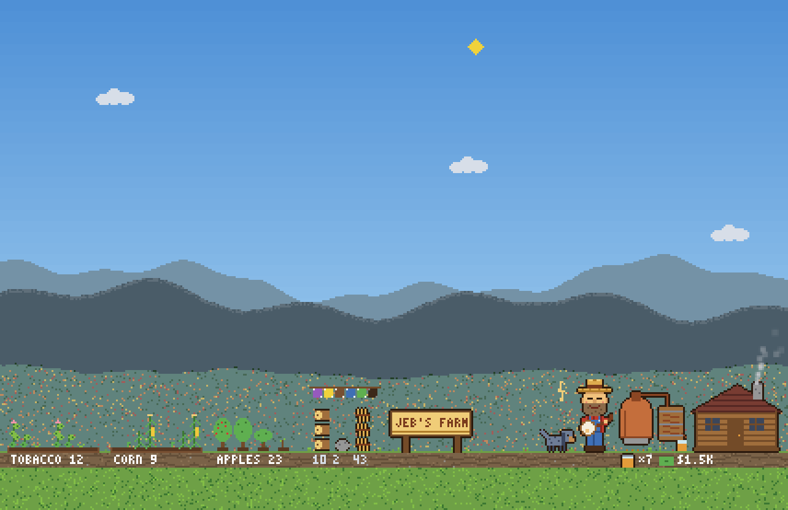

  

Jeb is a little farm that lives on your Mac's desktop and keeps track of your Claude Code sessions. A Claude Code plugin watches what your sessions get up to, and a desktop app draws it.

It's internal to Clevyr. The repo is private and proprietary (see [LICENSE](LICENSE)), so please don't share it outside the company.

**Latest release:** [github.com/clevyr/jeb/releases/latest](https://github.com/clevyr/jeb/releases/latest). The app download, `JebDesktop-<version>-macos.zip`, is listed under **Assets** at the bottom of that page. You don't need to download it yourself: the install below picks up the newest release, and Jeb keeps itself up to date after that.

## Getting Jeb

You need a Mac and Claude Code. Claude does the rest, and it takes about five minutes.

**1. Make sure you can see the repo.** Open [github.com/clevyr/jeb](https://github.com/clevyr/jeb) in your browser while signed in to GitHub. If you get a "not found" page, ask for access first.

**2. Ask Claude to install it.** Open Claude Code in any folder and paste this in:

    Install Jeb for me from github.com/clevyr/jeb. First make sure the GitHub CLI is installed and
    signed in (help me set it up if it isn't), and run gh auth setup-git. Then clone the latest release
    into ~/jeb and follow the install guide in that clone's .claude/skills/jeb-install/SKILL.md.

Claude checks what's missing and walks you through fixing it, one step at a time. It may ask you to install Apple's developer tools (a system pop-up; click Install and wait for it to finish) or to sign in to GitHub in your browser. When it's finished it tells you whether everything is healthy.

**3. Start a new Claude Code session.** Jeb only joins sessions started after the install. The farm looks pretty empty at first and fills in as you work.

## Using Jeb

There's nothing to run. Jeb starts when you log in, comes back on its own if it stops, and updates itself in the background.

It adds an item to the menu bar with:

- A status line showing whether it's running and at what frame rate, or why it's paused.
- **Pause / Resume** to stop and start drawing.
- **Frame rate**: Adaptive (the default, which slows down when nothing's moving), 60 fps or 30 fps.
- **Reload art** to pick up new plugin art without restarting.
- **Save Screenshot**, which saves a picture per screen to `~/Pictures/Jeb/` and shows it in Finder. It only saves what Jeb draws, never your other windows.
- **Restart** to start a fresh copy.
- **Quit Jeb Desktop**, which stops it until you next log in.

## If something looks wrong

The easiest fix is to ask Claude. Paste this into Claude Code:

    Check my Jeb install: follow ~/jeb/.claude/skills/jeb-doctor/SKILL.md and help me fix what it finds.

It runs a health check and explains each problem in plain words. Some common ones:

- **Nothing on the desktop and no menu bar item.** Jeb was quit or isn't running. Log out and back in, or type `jebctl start` in Terminal.
- **The menu bar says "Waiting for art".** Jeb can't find its files, usually because the `~/jeb` folder was moved or deleted. Put it back, or ask Claude to install Jeb again.
- **The desktop is empty.** Start a new Claude Code session; Jeb only joins sessions started after the install.

## Removing Jeb

In Terminal:

    cd ~/jeb
    ./uninstall

That removes the app and takes Jeb out of Claude Code. Your farm is kept in case you come back; `./uninstall --purge --purge-farm` removes everything. The `~/jeb` folder stays, so you can drag it to the Trash afterwards.

        

---

# For developers

Everything below is detail for people who want to know how Jeb works, install it by hand, or change it.

## What's in the repo

- `mod/` is the Claude Code plugin. Its hooks watch your sessions and write anonymized state to the plugin store.
- `desktop/` is the macOS app (Swift), plus the Python scripts that install, update and look after it.
- `creative/` is a scheduled builder that can extend the plugin. It's switched off, `./install` doesn't touch it, and nothing in here starts it.

## Requirements

- macOS, logged in to a desktop session.
- Xcode Command Line Tools (`xcode-select --install`). The app is bundled and signed on your machine (and built there too when no prebuilt one is available), so there's no notarization to deal with.
- `/usr/bin/python3` (comes with the Command Line Tools) and `git`.
- Claude Code (`claude` on your PATH), signed in with your own account.
- The GitHub CLI (`brew install gh`), signed in with access to this repo. Run `gh auth login`, then `gh auth setup-git` so git uses it too. Updates fetch in the background, so git has to reach the repo without asking for anything.

## Installing by hand

    tag=$(gh release view --repo clevyr/jeb --json tagName --jq .tagName)
    git clone --branch "$tag" https://github.com/clevyr/jeb.git ~/jeb
    cd ~/jeb
    ./install
    jebctl doctor

That clones the latest release (git will mention a "detached HEAD", which is expected). It has to be a git clone rather than a downloaded zip, because that's how Jeb updates itself. You can put it anywhere; the install remembers where. `./install --dry-run` shows every step without changing anything. It prints one short line per step; add `--verbose` for every command and detail.

The install:

1. Checks the requirements and stops with a message if anything's missing.
2. Pins the release signers and moves the clone to the newest signed release (see [Updates](#updates)). It needs a clean clone for this.
3. Gets the app (the release's prebuilt one when it can, see [Updates](#updates); otherwise it builds from source), runs a quick set of checks (compile, smoke test, headless start), then installs the LaunchAgents and starts it. If a check fails, the clone goes back to where it was and nothing gets installed.
4. Adds the clone's `mod/` folder to `CLAUDE_CODE_PLUGIN_DIRS` in `~/.claude/settings.json`. It backs that file up to `~/.claude/backups/jeb/` first and leaves your other entries alone. Running it twice is harmless.
5. Links `jebctl` into `~/.local/bin` so you can type plain `jebctl` from any folder. If that folder isn't on your PATH it offers to add it to your shell profile (`./install --add-path` adds it without asking); open a new terminal afterwards.

`./uninstall` keeps `~/Library/Application Support/Jeb` unless you pass `--purge`, and keeps the plugin's state file unless you pass `--purge-farm`, which backs it up before removing it. It also takes this clone's `mod/` back out of `CLAUDE_CODE_PLUGIN_DIRS` (backing up your settings first) and removes the `jebctl` link. `--dry-run` shows what it would do, and `--verbose` prints every command and detail.

## Commands

    jebctl status            # app, heartbeat, mode, last update, LaunchAgents
    jebctl doctor            # health check, one ok/FIX line per check
    jebctl start             # start it again after Quit
    jebctl quit              # same as Quit in the menu
    jebctl pause-updates     # stop following releases
    jebctl resume-updates
    jebctl rollback          # go back to the previous version
    jebctl screenshot        # same as Save Screenshot, prints the paths

`jebctl screenshot --fixture <name> [--out <dir>] [--hour <h>]` renders one of the test scenes to `<dir>/<name>.png` without touching the running app. `--list` shows the scene names. That's how the screenshots in this README were made (scaled up 3x with `desktop/src/tools/up <in> <out> 3`).

## Troubleshooting

Run `jebctl doctor` first. Every `FIX` line tells you what to do.

**Nothing on the desktop and no menu bar item.** It was quit, or it isn't running. Run `jebctl start`. If the LaunchAgents are gone, run `./install` again.

**A menu bar item that says "Waiting for art".** The app can't find the plugin's art (`mod/hooks/pixel-art.ts`), usually because the clone moved or was deleted. It checks every 30 seconds and carries on once the file is back. If you moved the clone, run `./install` from the new spot.

**The desktop is empty.** Start a new Claude Code session. The plugin only loads in sessions started after the install, and `doctor` will tell you whether it's registered and has written any state yet.

**Updates stopped.** `jebctl status` shows the last release check and any failed tags. Updates skip a clone with local changes or one that's on a branch, so commit or stash your changes, or run `./install` again. If the fetch is failing, check `gh auth status` and run `gh auth setup-git`. `doctor` also tells you if updates are paused.

**An update failed.** The previous version keeps running and the failed release isn't retried. `update.log` and `release.log` say why.

All the logs live in `~/Library/Application Support/Jeb/` (older installs stay at `~/.claude/jeb-desktop` until `jebctl migrate` or the next update moves them; the old path then links to the new one): `update.log` for builds and checks, `release.log` for release checks and `watchdog.log` for restarts.

## Updates

Jeb uses [Semantic Versioning](https://semver.org): releases are tags like `v1.4.2`, and installs follow the highest one. Pre-release tags (`v1.5.0-rc.1`) are never picked up. A LaunchAgent (`com.jeb.desktop.release`) checks at login and every 6 hours:

1. It runs `git fetch --tags origin` with your own credentials.
2. It looks at each newer tag, newest first. A tag has to be signed by a pinned signer and point at a commit on the default branch. One that fails is logged and skipped, so a bad tag can't block the real ones.
3. The first good tag is exported (`git archive <sha>`) into `~/Library/Application Support/Jeb/staging/<tag>/`, refusing anything that isn't a plain file or folder or that would land outside it. The new build then goes through the full checks: compile, smoke, parity, a scripted day and a headless start.
4. If everything passes, the clone moves to that commit (open sessions reload the plugin) and the new app replaces the old one. If the new app crashes or stops reporting in the next few minutes, the old one comes back and that tag is never tried again.

Each release carries a prebuilt app, so the checks in step 3 don't wait on a compile. Before building, the update downloads `JebDesktop-<tag>-macos.zip` from the GitHub release with `gh` and uses it only if its SHA-256 matches the `app-sha256` line in the signed tag message and it includes your Mac's architecture. If there's no such line (an older release), `gh` is missing, the download fails or the hash doesn't match, it builds from source instead, so an update never depends on the download. Either way the checks run on this Mac and the app is bundled and signed locally.

Updates leave the clone alone if it has local changes or is on a branch. `jebctl status` shows the install mode, the current release, the last check and any failed tags, and `jebctl follow --dry-run` shows what the next check would do.

### Signed releases

Releases are signed tags, and installs only trust signers pinned on that machine, so a tag pushed by anyone else is ignored.

- `desktop/release-signers` lists the allowed signers (`ssh-keygen` allowed_signers format, namespace `git`).
- The install copies it to `~/Library/Application Support/Jeb/release-signers` (mode 0600) if there isn't one already. Later tags and pulls can't replace it, so trust is fixed at install time.
- To rotate keys, update `desktop/release-signers` in a release, then run `./install --repin` on each machine.
- With no signer pinned, installs don't update at all. `status` and `doctor` show whether one is pinned.

## Contributing

### Setting up

You need everything from [Requirements](#requirements). Then work from a clone of `main` rather than a release, and install in dev mode:

    git clone https://github.com/clevyr/jeb.git ~/jeb-dev
    cd ~/jeb-dev
    ./install --dev

Dev mode runs straight from your working tree and doesn't follow releases. The update agent watches `desktop/src` and, once your edits have been quiet for a minute, builds them, runs the full checks and swaps the new app in if they pass. Run `jebctl pause-updates` while you're in the middle of something and `resume-updates` when you want it shipped. A build that fails a check isn't tried again; if the failure was a fluke, `desktop/jebctl retry-update` runs every check on it once more and ships it if they all pass. If you already have a release install, run `./uninstall` in that clone first so there's only one.

Make your changes on a branch and open a pull request against `main`.

### The desktop app

    cd desktop/src
    JEB_OUT=JebDesktop.dev ./build.sh

Don't launch `JebDesktop.dev` directly: a new copy takes over from the running app. Look at your changes through the tools instead. `jebctl screenshot --fixture <name>` renders a test scene with your build (set `JEB_BIN=desktop/src/JebDesktop.dev`), and the checks below run it offscreen.

To run every check the updater runs (compile, smoke, parity, a scripted day, headless start) on a snapshot of your source without installing anything:

    python3 -I desktop/updater.py --gates-only --force

That takes about 8 minutes. To run one piece with your dev build, from `desktop/src`: `JEB_BIN=JebDesktop.dev python3 -I tools/day.py kinds` (or `day`, `limit`, `evening`, `again`, `night`, `all`). The parity check compares each fixture against `fixtures/band-out.txt`, which is the reference output: don't regenerate it.

### The plugin

    claude plugin validate mod
    claude plugin test mod

A few rules the plugin has to keep, and the tests check most of them:

- Hooks only observe. No network, no processes, no file writes and no notifications. `$.model` (the daily Haiku calls) is only used in `hooks/signals.ts`.
- Nothing identifying leaves a session. See [Cost and privacy](#cost-and-privacy).
- A quiet tick makes no `$` calls at all.
- `tests/guard`, `tests/perf`, `tests/lore` and `tests/drops` are locked. Don't edit them; add new tests in a new file instead.

The plugin reloads in sessions started after a change.

### Art

The sprites come from `mod/art/src/build.py`, which needs Pillow (`python3 -m pip install --user Pillow`):

    python3 mod/art/src/build.py mod/art/out mod/hooks/pixel-art.ts

That rewrites `mod/hooks/pixel-art.ts` and writes previews to `mod/art/out/` (not tracked). Rebuild the logo and the plugin icon with `python3 mod/art/src/logo.py mod/hooks/pixel-art.ts docs mod/.claude-plugin/icon.png`.

### Commit messages and versions

Write commit subjects as [Conventional Commits](https://www.conventionalcommits.org), because the release reads them to pick the next version and write the release notes:

- `fix: ...` for a bug fix (patch release). `perf:` and `revert:` count the same.
- `feat: ...` for something new (minor release).
- `feat!: ...` (any type with `!`), or a `BREAKING CHANGE: ...` line in the body, for a change that breaks existing installs (major release).
- `docs:`, `test:`, `refactor:`, `chore:` and the rest don't trigger a release on their own.

A scope is fine too, like `fix(desktop): ...` or `feat(mod): ...`. Leave `"version"` in `mod/.claude-plugin/plugin.json` alone; the release sets it.

## Releasing

Releases are cut locally by the owner; there's no CI. Releases are signed tags, so once, from the clone:

    ./release setup

If this clone has no signing key yet, it makes one at `~/.ssh/jeb_signing` (it asks you for a passphrase) and points this clone's git at it. Then it writes `desktop/release-signers` from your git email and that key. Commit and push that file before the first release. Back the key up somewhere safe, like a password manager: if it's lost, every install has to run `./install --repin` to trust a new one. Git asks for the passphrase once each time you release.

To get a "Verified" badge on the tags on GitHub, also add `~/.ssh/jeb_signing.pub` to your account as a *Signing Key* (Settings, then SSH and GPG keys). Installs don't need it.

From a clean checkout of `main`, one command cuts a release and puts it on GitHub:

    ./release

It works out the version the way release-please does, from the [commit messages](#commit-messages-and-versions) since the last release: any breaking change makes it a major release, otherwise any `feat` makes it minor, otherwise any `fix`, `perf` or `revert` makes it a patch. If there's nothing releasable it says so and stops. The release notes are built from the same commits, grouped into breaking changes, features and fixes. The very first release is 1.0.0. The version always comes from the release tags and the commits, never from a number you set; the release writes it into `mod/.claude-plugin/plugin.json` for the record.

Add `--dry-run` to see the version and notes it would use without changing anything. To force a level, pass it: `./release patch`, `./release minor` or `./release major`.

It validates and tests the plugin, does a universal release build (arm64 and x86_64) and runs the parity checks on that binary. Only if all of that passes does it write the new version to `plugin.json`, commit it as `chore(release): v<version>` and make a signed `v<version>` tag. The tag message records the SHA-256 of the zipped release build, and that zip is attached to the GitHub release as `JebDesktop-<tag>-macos.zip`. A failed check leaves nothing behind. It then asks once, and on `y` pushes the branch and tag and publishes the GitHub release with those notes and the zip, which is what new installs clone. That last step needs `gh` signed in. If the release can't be created, the tag is still pushed and it prints the command to retry.

It doesn't use release-please itself because that tool creates tags on GitHub's side, unsigned, and installs only follow tags signed by a pinned key.

Existing installs pick the tag up on their next check either way. On GitHub, it's worth protecting `v*` tags and `main` so only the owner can create or move them.

## Cost and privacy

The plugin calls Haiku at most 9 times a day, on your own Claude account.

No work names, paths or text ever leave a session. The plugin keeps an area key (a keyed SipHash-2-4 hash, truncated, under a secret unique to your install) and a handful of coarse values. Ticket keys, repo names, prompts and tool output are reduced to those before anything is written, and the tests check that the raw strings never show up in the stored state.

## Where things live

Code runs from the clone and state lives outside it:

- `~/Library/Application Support/Jeb`: logs, installed versions, heartbeat, telemetry, updater and release state, staging.
- `~/.claude/jeb-creative`: the builder's changelog, run log, lock and output (unused while it's off).
- `~/.claude/plugins/store/`: the plugin's state file, which the desktop reads.

The installed app finds the plugin through the `JebMod` key in its `Info.plist`, written at build time. `JEB_MOD` overrides it, and a dev build falls back to the `mod/` folder next to `desktop/`.

Environment variables, mostly for tests (the install sets the paths itself):

- `JEB_HOME`: desktop state folder (default `~/Library/Application Support/Jeb`).
- `JEB_SRC`: app source for `jebctl` and `updater.py` (default `desktop/src`).
- `JEB_MOD`: the plugin folder, used to find `hooks/pixel-art.ts`.
- `JEB_BUNDLE_MOD`: the folder written into the bundle's `JebMod` key (default `JEB_MOD`). Release updates point it at the clone's `mod/`, since the staged copy is deleted afterwards.
- `JEB_APP_DIR`: where `JebDesktop.app` goes (default `~/Applications`).
- `JEB_LAUNCHAGENTS`: where the LaunchAgent plists go (default `~/Library/LaunchAgents`).
- `JEB_BIN_DIR`: where `./install` links `jebctl` (default `~/.local/bin`). `JEB_PROFILE`: the shell profile it adds that folder to (default `~/.zprofile`, `~/.bash_profile` or `~/.profile` by `$SHELL`).
- `JEB_SETTINGS`, `JEB_BACKUPS`, `JEB_STORE_DIR`: the settings file, its backups and the store folder, for `./install`, `./uninstall` and `jebctl doctor`.
